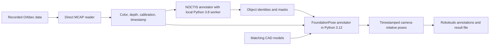

# Recorded Orbbec object pose analysis engine: design interview

These notes preserve the design interview and codebase findings that inform the
implementation specification in [spec.md](spec.md). The specification is the source
for implementation scope and readiness.

## Requested outcome

Create a Robokudo analysis engine with one NOCTIS annotator and one FoundationPose
annotator. Input is the recording in `recorded_sensor_data/`; output is object 6D poses.
Use the supplied `noctis_acrambly/`, `robokudo_foundation_pose/`, and
`robokudo_cad_data_new/` assets. This document records the design interview;
implementation has not started.

## Agreed design

- Read `recorded_sensor_data/01_0.mcap` directly and process matched observations in
  recording order. Pair color and depth by acquisition timestamps without a mandatory
  maximum offset; keep one-to-one matching, preserve both source timestamps, and
  explicitly record inputs that cannot be paired. Support bounded diagnostic runs;
  the default covers the recording and stops at its end.
- For each matched observation, run the NOCTIS annotator and then the FoundationPose
  annotator before advancing. Each frame receives independent estimates. Duplicate
  physical instances and persistent tracking are outside the initial scope.
- Use NOCTIS IDs 1 and 2 for `child_cube_0_colored.ply` and
  `child_cube_2_colored.ply`, respectively. Both CAD geometry and recorded depth use
  millimetres. Report original CAD-frame poses in `camera_color_optical_frame`, with
  translation in metres, quaternion order `xyzw`, and the color acquisition timestamp.
- Run Robokudo/FoundationPose with `.venv-foundation-pose/` Python 3.12 and a persistent
  local NOCTIS worker with `noctis_acrambly/.venv/` Python 3.8. Target the user's RTX
  3080 with 10 GiB memory and execute the GPU stages sequentially.
- Retain stamped poses and structured per-target results in Robokudo. Export one
  JSON Lines record per color frame, containing both configured targets and any
  failure reasons. Write `poses.jsonl`, `summary.json`, and selected CAD overlays in
  separate run subdirectories of the fixed repository-root `orbbec_pose_results/`.
  This directory is ignored by Git; its location is not configurable.
- Continue after missing detections, invalid masks, insufficient depth, or unmatched
  input data. Stop with an actionable error for invalid startup configuration,
  unavailable CUDA/models, or a dead worker. Preserve completed output.
- Develop with failing pytest tests first and mock-based CI coverage. Initial local
  quality acceptance uses visual alignment of projected CAD meshes on representative
  recorded frames; slower-than-recording processing is acceptable. Validate model
  compatibility and peak GPU memory locally before the complete replay.

## Established facts

- The input is a ROS2 MCAP recording, approximately 66.7 seconds long. Its metadata
  lists compressed color, raw depth, color camera calibration, static transforms,
  and no dynamic transform messages. Full payload inspection now establishes image
  encoding, calibration, frames, and timestamp relationships. The user confirmed the
  millimetre interpretation for recorded depth. The MCAP summary resolves the
  metadata count disagreement.
  Source: [recording metadata](../../recorded_sensor_data/metadata.yaml).
- NOCTIS performs RGB instance segmentation and matches detections to reference
  objects. Its outputs include masks, pixel bounding boxes, object identities, and
  scores. It does not estimate 6D poses. The current prompt is `tetris block`.
  Sources: [NOCTIS overview](../../noctis_acrambly/README.md),
  [detector](../../noctis_acrambly/src/model/detector.py),
  [segmentor configuration](../../noctis_acrambly/configs/model/segmentor_model/grounded_sam.yaml).
- NOCTIS currently keeps only the best detection for each object identity. It also
  needs explicit handling of frames with no detections. Its masks may contain
  fractional values that need conversion to the pose estimator's binary mask contract.
  Sources: [detector](../../noctis_acrambly/src/model/detector.py),
  [detection filtering](../../noctis_acrambly/src/model/utils.py),
  [segmentation](../../noctis_acrambly/src/model/grounded_sam.py).
- An existing FoundationPose annotator accepts object hypotheses with classifications,
  bounding rectangles, cropped segmentation masks, and CAD mappings. It also needs
  color, depth, camera intrinsics, and the color-to-depth resolution ratio. Its current
  depth conversion assumes millimetres; image resizing alone cannot establish depth
  registration. Default pose output is camera-relative, with translation in metres
  and quaternion order `xyzw`.
  Source: [FoundationPose annotator](../../robokudo_foundation_pose/robokudo_foundation_pose/robokudo_foundation_pose/annotator/foundation_pose_annotator.py).
- The supplied CAD directory contains `child_cube_0_colored.ply` and
  `child_cube_2_colored.ply`. Exact SHA-256 matches establish that the first is NOCTIS
  custom model `obj_000001.ply` and the second is `obj_000002.ply`. The user confirmed
  that both files use millimetres. The template-rendering log records these inputs,
  and the renderer re-centers them by default; the geometry frame used for templates must therefore be
  distinguished from the original mesh frame used for final poses.
  Source: [template render log](../../noctis_acrambly/logs/render_bop_template.log).
- FoundationPose can emit an initial translation guess with identity orientation when
  masked depth is insufficient. The annotator currently publishes that guess as an
  ordinary pose. The agreed failure policy requires replacing that behavior with an
  explicit no-pose result.
  Source: [FoundationPose estimator](../../robokudo_foundation_pose/robokudo_foundation_pose/robokudo_foundation_pose/estimater.py).
- Robokudo has pose annotations with frame and timestamp support, but the current
  FoundationPose annotator emits the unstamped variant. Its refinement option does
  not itself associate object identities across frames.
  Sources: [annotations](../../robokudo/src/robokudo/types/annotation.py),
  [pose types](../../robokudo/src/robokudo/types/tf.py).
- The existing Orbbec camera configuration matches the recording's topics. Its ROS
  subscriber retains the latest synchronized input, so replay speed can cause skipped
  frames during slow inference. The image file reader cannot directly read MCAP.
  Sources: [Orbbec configuration](../../robokudo/src/robokudo/descriptors/camera_configs/config_orbbec.py),
  [camera interface](../../robokudo/src/robokudo/io/camera_interface.py),
  [image file reader](../../robokudo/src/robokudo/io/file_reader_interface.py).
- FoundationPose requires CUDA. Local checkpoints exist for both systems, but model
  loading, dependency compatibility, GPU execution, and offline readiness have not
  been tested. NOCTIS currently has no Robokudo annotator integration. The existing
  FoundationPose environment is Python 3.12.3 with PyTorch 2.7.1; NOCTIS has a separate
  Python 3.8 environment with PyTorch 2.2.1 and xformers pinned to that version. The
  installed dependencies cannot simply be combined; migration to a shared runtime
  would be additional, unverified work. The user supplied host GPU information:
  NVIDIA GeForce RTX 3080 with `10,240 MiB` memory, driver `580.178.04`, and a reported
  maximum CUDA version of `13.0`. At the supplied measurement, graphics processes
  used `666 MiB`. This establishes the hardware target; combined model memory use
  remains to be measured during implementation. The tool environment's earlier GPU
  visibility failure does not contradict the supplied host report.
- The native MCAP inspection tool confirms 5,872 messages in the recording. ROS2/CDR
  payload decoding succeeded using the approved Python 3.12 environment and ROS
  Jazzy's `rosbag2_py`, without playback or new dependencies.

## Proposed data flow

## Design tree

The root requirement is an engine that turns the supplied recording into object poses
using the two annotators. The first round settles scope and the meaning of the output.

### Round 1: confirmed decisions

1. **Target objects:** `child_cube_0_colored.ply` and `child_cube_2_colored.ply`
   represent separate rigid objects and are the complete initial target set.
2. **Multiple instances:** Duplicate physical copies of one model are outside the
   initial scope. Keep NOCTIS's existing per-model detection filtering.
3. **Temporal behavior:** Estimate poses independently for each processed frame.
4. **Output use:** Retain timestamped camera-relative poses in Robokudo and export them
   to a result file. Include object identity, camera frame, translation in metres, and
   orientation as an `xyzw` quaternion. The output frame is
   `camera_color_optical_frame`; the export is JSON Lines as settled below.
5. **Failed estimates:** Emit an explicit no-pose result with a reason for missing
   detections or unusable depth, and continue processing. Do not publish an unvalidated
   initialization guess as a successful pose.

### Follow-up findings

The CAD-to-NOCTIS identity mapping is settled by file equality:

| NOCTIS object ID | Supplied CAD file |
| --- | --- |
| 1 | `child_cube_0_colored.ply` |
| 2 | `child_cube_2_colored.ply` |

The models' approximate bounding-box dimensions, decoded from PLY vertices, are
`49.998 × 203.051 × 49.998 mm` and `152.034 × 101.016 × 101.016 mm`.
Their bounding-box centers are approximately `(99.615, 178.358, 24.999)` and
`(225.760, 128.702, 50.508)`, so original CAD origins differ from geometric centers.
The user confirmed millimetres independently of the template renderer's size heuristic.
Set FoundationPose's mesh scale to `0.001` for both models; its default scale `1.0`
would disagree with the required metre conversion. Source:
[template renderer](../../noctis_acrambly/scripts/pyrender_custom.py).

The reference descriptor cache has no checked provenance tying it to the final model
order, template list, or embedding configuration. Recomputing it with the final
configuration is proposed; existing cache presence does not establish correctness.

Direct MCAP reading is supported by local precedents and available dependencies.
Unlike the existing latest-frame subscriber, a reader can advance after inference
completes and therefore avoid dropping frames because inference is slow.

### Decoded sensor contract

Full-recording inspection is saved in
[recording-inspection.json](recording-inspection.json).

- There are 1,956 JPEG color images, 1,955 depth images and 1,955 calibration messages.
  All images are `1920 × 1080`. Depth encoding is little-endian `16UC1`.
- All three image/calibration topics declare `camera_color_optical_frame`. Use that
  frame for poses. Treat the depth grid as registered to color according to the
  recorded headers; do not apply the physical color-depth extrinsic a second time.
  Check registration visually during acceptance.
- Calibration is constant. It includes nonzero `plumb_bob` distortion. Rectify color
  and its registered depth consistently before segmentation and pose estimation,
  preserving invalid depth pixels and using nearest-neighbor depth resampling. Use
  the resulting pinhole intrinsics for masks, estimation, and diagnostic projection.
  This image rectification does not change the reported camera coordinate frame.
- Acquisition timestamps are unique and monotonic within each topic. Inspection with
  a `2 ms` tolerance found 1,955 unique pairs, each with exact-stamp color calibration.
  The largest observed absolute offset among those pairs is `1.001216 ms`. This
  measurement does not make that tolerance a required runtime restriction.
- The initial color image has no exact-stamp calibration and its nearest depth is
  `33.999872 ms` later. Report it explicitly rather than consuming a later frame's
  depth. Preserve source acquisition timestamps at nanosecond precision; use color
  time for pose stamps and retain paired depth time and offset in the result record.
- [ROS REP 118](https://reps.openrobotics.org/rep-0118/) defines the unsigned-16-bit
  raw depth representation in millimetres, with zero meaning invalid depth. The user
  confirmed that interpretation for this recording. Capture parameters and SDK scale
  are absent from the bag; the interpretation is an agreed input contract, rather
  than independently reconstructed producer settings.

### Round 2: confirmed decisions

6. **Recording reader:** Read MCAP directly, process every usable synchronized
   color-depth pair at inference speed, and stop at the end of the recording.
   Expose frame selection for short diagnostic runs.
7. **Runtime:** Keep Robokudo and FoundationPose in `.venv-foundation-pose/` with
   Python 3.12. Run NOCTIS as a persistent local worker in `noctis_acrambly/.venv/`
   with Python 3.8. The engine still has one annotator for each model.
   See [runtime decision](../../docs/adr/0001-isolate-noctis-runtime.md).
8. **CAD scale:** Both supplied CAD files use millimetres, confirmed by the user.
   Apply mesh scale `0.001` for metre-based estimation and output.
9. **Object coordinate frame:** Each pose refers to the original coordinate origin
   stored in its CAD file. Do not replace it with the geometric center.

### Proposed implementation defaults

- Retain the existing `noctis_acrambly` prompt `tetris block` and its configuration
  thresholds, including strict final detection confidence greater than `0.4`.
  Detection confidence must not be presented as pose accuracy or pose confidence.
- Use explicit NOCTIS object order `[1, 2]` and existing level-0 template selection.
  Recompute reference descriptors once for the final configuration; templates need
  not be regenerated. Load existing model sources and weights locally and validate
  their availability during startup.
- Initialize one persistent NOCTIS worker, wait until it is ready, process one request
  at a time, correlate replies with frame identities, and release it at shutdown.
  Keep model-loading and reference initialization separate from recording frame IDs.
- Process the same matched color/depth observation through NOCTIS and then
  FoundationPose before advancing. Timestamp pairing refers to acquisition times;
  neither acquisition spacing nor the earlier suggested `2 ms` tolerance limits
  inference duration. Validate combined peak GPU memory on the RTX 3080 before a
  full replay, and keep the two stages' GPU computations sequential.
- Preserve one result for each configured target in every color-frame record, including
  a reason when there is no pose. Retain successful stamped pose annotations in CAS;
  do not invent detections for missing targets.
- Evaluate insufficient depth at the estimator's existing authoritative check after
  erosion and filtering. Name its existing threshold and return a typed failure
  instead of the current identity-orientation guess. A raw-depth precheck is not
  equivalent and must not duplicate this decision.
- Serialize the same structured result objects retained in CAS through the existing
  dataclass serialization support. Preserve full ROS timestamps; do not route this
  export through converters that discard nanoseconds or leave the camera frame empty.
- Write results under the fixed repository-root directory `orbbec_pose_results/`,
  ignored by Git through the root `.gitignore`. Create a separate subdirectory per
  run containing `poses.jsonl`, `summary.json`, and diagnostic images under `overlays/`.
  Preserve partial results on interruption and do not overwrite earlier runs. The
  summary includes frame/outcome counts and elapsed processing time. Do not add an
  output-directory option for this initial version.
- Add meaningful failing pytest tests before implementation. Cover pairing and
  calibration, image/mesh units and frames, worker requests and empty detections,
  mask conversion, stamped poses, filtered-depth failures, export round-trips, and
  continued export after per-target failure. Reuse existing fixtures. CI tests mock
  model/worker boundaries and require neither GPU, checkpoints, network nor credentials.
  Keep any real GPU checks conditional and pair them with mock-based CI coverage.

### Round 3: confirmed decisions

10. **Depth interpretation:** Recorded `16UC1` depth uses one millimetre per count.
    Verify metric consistency against the confirmed CAD sizes.
11. **Synchronization:** The user does not require the suggested `2 ms` constraint.
    Confirmed clarification: match color and depth by acquisition timestamps without
    a mandatory maximum offset, retain one-to-one matching and source timestamps,
    and run both annotators sequentially on each matched observation. Report inputs
    that cannot be paired rather than inventing a pose.
12. **Reviewable output:** Save JSON Lines and selected diagnostic CAD overlays under
    the fixed, Git-ignored repository-root directory `orbbec_pose_results/`. The
    output location does not need to be configurable.
13. **Unrecoverable failures:** Stop with an actionable error for invalid startup
    configuration, unavailable CUDA/models, or a dead worker, preserving written
    results. Missing detections, invalid masks, and insufficient depth remain
    recoverable per-frame or per-target outcomes.
14. **Initial acceptance:** Use visual CAD-overlay alignment on representative recorded
    frames as the initial pose-quality acceptance criterion. Offline processing may
    be slower than the recording. No ground-truth poses or numerical accuracy target
    have been supplied; tests still verify deterministic contracts and failures.

### Implementation and validation sequence

1. Add failing pytest coverage for recorded-frame pairing, units, rectification, and
   timestamp/frame preservation; implement the direct reader and its typed input data.
2. Add failing tests for the persistent NOCTIS worker boundary, empty results and mask
   conversion; integrate its annotator with the final ordered target references.
3. Add failing tests for stamped pose output and explicit estimator failures; integrate
   FoundationPose with millimetre mesh/depth scaling and original CAD origins.
4. Add failing tests for export and failure continuation; compose the analysis engine
   and a documented command-line entrypoint using the selected project interpreter.
5. Run CPU/mock pytest coverage in CI. Locally validate model loading, representative
   frames with both objects, memory use on the 10 GiB RTX 3080, saved overlays, and a
   bounded replay before attempting the complete recording. Keep any GPU tests
   conditional on actual local assets and hardware.

The runtime isolation trade-off is recorded in an accepted architecture decision.
GPU memory, model compatibility and actual pose quality are implementation validation
tasks; they are not claimed as already verified by this design interview.

## Comments

- Round 1 user answers: target objects yes; duplicate instances not needed currently;
  independent estimation yes; timestamped camera-relative output and export yes;
  explicit no-pose results and continued processing yes.
- Round 2 user answers: direct MCAP reader yes; separate environments yes; mesh units
  explicitly confirmed as millimetres; original CAD coordinate origins yes.
- Round 3 user answers: depth in millimetres yes; `2 ms` synchronization is not
  mandatory; fixed repository-root output location ignored by Git; fatal startup and
  worker failures stop the run; visual acceptance and offline processing yes.
- User supplied an RTX 3080 host report showing 10,240 MiB total GPU memory.
- The user confirmed the Q11 clarification: timestamp-based pairing without a
  mandatory `2 ms` cutoff, followed by sequential NOCTIS and FoundationPose inference
  on the same matched input before advancing.
