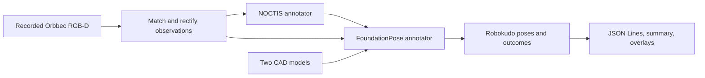

# Recorded Orbbec object pose analysis engine

Status: ready-for-agent

Review: synthesized from the design interview; testing boundaries confirmed by the user.

## Problem Statement

The supplied Orbbec recording contains color images, depth images, and camera
calibration, but there is no Robokudo analysis engine that combines NOCTIS object
recognition with FoundationPose estimation for the supplied rigid objects. The
existing camera subscriber can skip recorded frames while inference runs, and the
models depend on separate Python environments.

The user needs an offline run that produces usable 6D poses in the recorded camera
frame, retains those poses in Robokudo, and saves results and visual evidence for
review. A missing detection or an unusable observation must be distinguishable from
a successful pose, including when an estimator can only produce an initialization
guess.

## Solution

Provide an offline Robokudo analysis engine with one NOCTIS annotator followed by
one FoundationPose annotator. Read the supplied MCAP recording directly, match
color and depth using their acquisition timestamps, and process each matched
observation through both annotators before advancing.

NOCTIS identifies each configured object and supplies its segmentation mask.
FoundationPose estimates the original CAD frame relative to the recorded color
camera frame. Each color-frame result contains an outcome for both target objects:
either a stamped pose with translation in metres and an orientation quaternion, or
an explicit reason why no pose was produced. Save the results incrementally and
produce selected projected CAD overlays for visual review.

## User Stories

1. As a perception developer, I want one documented command to run the recorded-data
   analysis engine, so that I can obtain poses without starting live camera capture.
2. As a perception developer, I want the supplied MCAP recording read directly, so
   that I do not need to extract and maintain a separate image dataset.
3. As a perception developer, I want every usable recorded observation processed at
   inference speed, so that slow model execution does not silently skip input.
4. As a perception developer, I want the default run to stop at the end of the
   recording, so that offline processing completes without looping the input.
5. As a perception developer, I want a bounded run or selected frames for diagnostics,
   so that I can validate the pipeline before processing the complete recording.
6. As a perception developer, I want color and depth matched by capture time, so that
   the two annotators receive the same physical observation.
7. As a perception developer, I want each depth image used at most once, so that an
   unmatched color image cannot shift all later color-depth associations.
8. As a perception developer, I want timestamp matching without a mandatory maximum
   offset, so that the earlier suggested 2 ms cutoff does not reject observations.
9. As a perception developer, I want unpaired images and missing calibration reported,
   so that incomplete input is visible in the results.
10. As a perception developer, I want both source acquisition timestamps and their
    offset preserved at nanosecond precision, so that I can inspect synchronization.
11. As a perception developer, I want recorded camera calibration applied consistently
    to color, depth, masks, and projection, so that pose estimation uses one image grid.
12. As a perception developer, I want invalid depth to remain invalid during image
    preparation, so that preprocessing does not create false surface measurements.
13. As a perception developer, I want one NOCTIS annotator and one FoundationPose
    annotator in the engine, so that the responsibilities of the two models are clear.
14. As a perception developer, I want NOCTIS to recognize both supplied rigid objects
    using their existing references, so that detections map to the correct CAD models.
15. As a perception developer, I want the best detection retained for each model, so
    that the initial engine follows the agreed single-instance scope.
16. As a perception developer, I want segmentation masks converted into valid Robokudo
    object hypotheses, so that FoundationPose receives the intended image regions.
17. As a perception developer, I want a frame with no detections to produce explicit
    no-pose outcomes, so that an ordinary empty scene does not crash the run.
18. As a perception developer, I want the existing NOCTIS and FoundationPose runtimes
    reused, so that dependency migration is not a prerequisite for this engine.
19. As a perception developer, I want NOCTIS initialized once in a persistent worker,
    so that model loading is not repeated for every recorded frame.
20. As a perception developer, I want both GPU stages run sequentially on each matched
    observation, so that the pipeline has a clear execution order on the RTX 3080.
21. As a perception developer, I want a new estimate for every processed frame, so
    that results do not depend on tracking or a pose from a previous frame.
22. As a perception developer, I want millimetre depth and CAD geometry converted
    consistently, so that exported translations are expressed in metres.
23. As a perception developer, I want each pose to refer to the original CAD origin,
    so that downstream use agrees with the supplied object's coordinate frame.
24. As a perception developer, I want every successful pose stamped with the color
    acquisition time and camera frame, so that Robokudo retains its spatial meaning.
25. As a perception developer, I want orientation exported in xyzw quaternion order,
    so that consumers can interpret it consistently.
26. As a perception developer, I want insufficient filtered depth reported as no pose,
    so that an initialization guess is not mistaken for a successful 6D estimate.
27. As a perception developer, I want invalid masks and malformed pose results reported
    explicitly, so that unusable per-target results do not contaminate successful ones.
28. As a perception developer, I want one target's expected failure to allow the other
    target and later frames to finish, so that a partial observation remains useful.
29. As a perception developer, I want successful stamped poses and structured outcomes
    retained in Robokudo, so that they remain available to other perception stages.
30. As a perception developer, I want one JSON Lines record per color frame in the run,
    containing both target outcomes, so that absent results are unambiguous.
31. As a perception developer, I want exported results to retain the same values as
    the Robokudo results, so that file review agrees with the engine's annotations.
32. As a perception developer, I want a separate output directory for each run, so that
    a new run preserves earlier results.
33. As a perception developer, I want completed records preserved on interruption or
    fatal failure, so that useful work can still be inspected.
34. As a perception developer, I want output in a fixed repository-root directory
    ignored by Git, so that generated results require no output-location setup.
35. As a perception developer, I want a summary of inputs, outcomes, and elapsed
    processing time, so that I can assess completeness and processing cost.
36. As a perception developer, I want selected CAD projections overlaid on recorded
    color frames, so that I can judge initial pose quality visually.
37. As a perception developer, I want missing assets, unavailable CUDA, and worker
    failure to stop with actionable errors, so that infrastructure failures are clear.
38. As a perception developer, I want deterministic CPU tests with model dependencies
    replaced, so that CI can validate the feature without a GPU or private data.
39. As a perception developer, I want failing tests written before each implementation
    slice, so that the intended behavior is demonstrated by a regression check.
40. As a perception developer, I want representative local GPU runs before a complete
    replay, so that model compatibility, memory use, and pose overlays are checked.

## Implementation Decisions

1. **Engine composition.** Compose recorded-input acquisition, the NOCTIS annotator,
   the FoundationPose annotator, and result export through Robokudo's existing
   analysis-engine and pipeline interfaces. Use exactly one annotator per model;
   acquisition and export may have their own stages. The offline launcher must
   terminate cleanly at end of input and expose bounded or frame-selected runs.

2. **Recorded input.** Use the locally available ROS2 MCAP decoding support in the
   primary environment. Read acquisition timestamps from message headers rather than
   substituting playback time, receipt time, or elapsed inference time. Keep recorded
   ordering, pair color and depth one-to-one by acquisition timestamps, preserve both
   timestamps, and do not impose a mandatory maximum offset. Matching must protect
   closer valid associations from being consumed by an earlier unmatched image;
   pairing by message position alone is insufficient. Report unused depth messages
   in run diagnostics, and give unpaired color frames explicit target outcomes.

3. **Calibration and image preparation.** Decode compressed color into the color
   representation expected by Robokudo and convert explicitly for each model's input.
   Use the recorded color calibration for the associated observation. Report missing
   or incompatible calibration as an unusable observation. The supplied depth image
   declares the color optical frame and shares its image dimensions: treat it as
   registered to color, without applying the physical depth-to-color extrinsic again.
   Rectify color and registered depth consistently for the recorded distortion. Use
   nearest-neighbor depth resampling and retain zero as invalid depth. Segmentation,
   pose estimation, and overlay projection must use the same rectified pinhole grid
   and resulting intrinsics. Rectification does not change the output camera frame.

4. **Object identity.** Support the two supplied object models and their verified
   NOCTIS identities. Preserve the existing best-per-model detection filtering;
   duplicate physical instances are outside this version. Associate classifications,
   masks, CAD geometry, stamped poses, and exported outcomes through that single
   target mapping. Do not create object hypotheses for undetected targets.

5. **NOCTIS configuration.** Reuse the existing supplied NOCTIS configuration,
   including the prompt and thresholds recorded in Further Notes. Fix the reference
   order to the two agreed identities and use the existing level-zero template
   selection. Recompute reference descriptors once with the final configuration
   rather than trusting an existing cache without provenance. Reuse rendered
   templates and load model sources and weights from available local assets.
   Detection scores describe recognition, not pose accuracy or pose confidence.

6. **NOCTIS output contract.** Transfer detected model identity, detection score,
   pixel bounding rectangle, and segmentation mask into Robokudo object hypotheses.
   Convert fractional model masks to explicitly binary, correctly cropped masks;
   validate image bounds and mask dimensions before pose estimation. Handle no
   proposals, empty masks, and no retained detections as ordinary empty results.

7. **Runtime isolation.** Run Robokudo and FoundationPose in the existing Python 3.12
   environment and NOCTIS in its existing Python 3.8 environment, following the
   accepted runtime-isolation decision. The NOCTIS annotator owns one persistent
   local worker, waits for readiness after model and reference initialization,
   correlates requests and responses with observation identities, and releases the
   worker at shutdown. Separate model initialization from source frame numbering.
   Allow one outstanding inference request and run NOCTIS then FoundationPose on the
   same matched observation before advancing. Sequential execution does not by itself
   prove that both resident model sets fit in GPU memory.

8. **Independent pose estimation.** Reuse the existing FoundationPose annotator and
   estimator with the agreed CAD mapping. Estimate each processed observation
   independently, with tracking disabled. Convert millimetre sensor depth and CAD
   geometry to metres consistently, applying a mesh scale of 0.001. Preserve the
   estimator's conversion back from centered internal geometry to the original CAD
   frame. Produce camera-relative poses without applying a world-frame transform.

9. **Authoritative insufficient-depth outcome.** FoundationPose's existing check
   counts valid masked pixels after depth erosion and filtering. Retain that decision
   point and its current threshold, giving the threshold a meaningful named
   definition. Replace the below-threshold initialization-guess return with a typed
   insufficient-depth outcome. The annotator records that outcome and continues;
   a separate raw-depth check must not replace or duplicate the filtered-depth rule.

10. **Pose contract.** A successful pose contains the original CAD frame's translation
    in metres and rotation as a finite xyzw quaternion relative to the recorded
    color optical frame. Preserve the color acquisition timestamp with seconds and
    nanoseconds in Robokudo's existing stamped pose annotation. Validate malformed
    or non-finite estimator output before publishing it. Avoid conversion routes
    that lose nanoseconds or default to an empty frame.

11. **Structured results.** Define dataclasses for an observation's metadata and
    per-target outcomes. Every included color frame has exactly one outcome for each
    configured target. Each target has either its stamped pose or a typed no-pose
    reason; no-pose outcomes do not contain a placeholder pose. Retain the structured
    results in Robokudo alongside successful object hypotheses and annotations.
    Preserve integer source timestamps, paired depth time and signed offset when
    available, frame identity, target identity, and detection score when available.

12. **Failure handling.** Expected missing input, missing detections, invalid masks,
    insufficient filtered depth, and invalid per-target estimates are result data.
    They must allow export and subsequent observations to continue. One failed target
    must not suppress another target's valid pose. Invalid startup configuration,
    unavailable required models or CUDA, and a dead or unusable worker are fatal:
    stop with an actionable error and preserve completed output. Do not report a
    fatal execution failure as a successful frame or invent a model result.

13. **Export and diagnostics.** Write one JSON Lines record per included color frame,
    including unusable or unpaired color observations and both target outcomes.
    Serialize the same structured results retained in Robokudo using the existing
    KRROOD dataclass and subclass serialization support. Export only result data,
    without full sensor arrays or the complete scene. Write each run into a new
    subdirectory of the fixed Git-ignored output directory. Preserve earlier runs
    and flush completed records incrementally. Save a run summary with frame counts,
    outcome counts, unmatched input counts, and elapsed processing time. Preserve
    completed records on fatal failure or interruption; summarize partial runs when
    shutdown can execute. Save selected CAD overlays using the same pose, rectified
    image grid, metric geometry, and intrinsics as estimation.

14. **Delivery and validation.** Document the offline command using the selected
    project interpreter and any required local ROS environment setup. Resolve only
    packaging and startup issues required to run this engine in the selected
    environments. Develop in test-first behavioral slices, register new tests with
    the existing CI suite, and validate representative frames and combined peak GPU
    memory locally before a full replay.

## Testing Decisions

### Agreed public testing boundaries

The user confirmed these boundaries. Prefer these existing public interfaces and
their observable outputs over new test-only helpers or private-method tests.

| Boundary | What it verifies | What it does not establish |
| --- | --- | --- |
| Offline analysis-engine execution: a small recorded input through the real reader, preprocessing, annotators, and export | Pairing, calibration, rectification, target mapping, stage ordering, pose units and frames, nanosecond timestamps, result persistence, recoverable failures, EOF, bounded runs, and worker lifecycle | Recognition quality, physical pose accuracy, or real GPU memory use when model computation is replaced |
| NOCTIS's public inference and worker request/response interface, with heavyweight model dependencies replaced | Empty proposals and retained detections, mask and identity transfer, one-time initialization, readiness, observation correlation, and worker failure | Real checkpoint compatibility or the quality of learned segmentation and matching |
| FoundationPose's existing public registration interface, with GPU computation replaced deterministically | The authoritative post-filter insufficient-depth outcome and preservation of the original scaled CAD frame in successful estimation | Real refinement quality or CUDA kernel correctness |

The analysis-engine boundary is the primary place for behavior tests. The two model
boundaries cover production behaviors that an engine test with model computation
replaced cannot prove. Exercise lifecycle and serialization through the engine or
public worker contract rather than adding separate internal testing interfaces.

### Required behavioral coverage

- Pair known color/depth fixtures by acquisition time without reusing depth, including
  a leading unmatched color, competing timestamps, offsets greater than 2 ms, and
  a clean end of input. Verify that a missing calibration or unmatched color does
  not consume the depth belonging to a later valid observation.
- Preserve source time at nanosecond precision and use the color acquisition time
  for successful stamped annotations and exported poses.
- Exercise recorded image decoding and rectification with controlled calibration.
  Verify common image dimensions and pinhole intrinsics, correct model color input,
  nearest-neighbor depth behavior, and preservation of invalid zeros.
- Verify known metric examples from depth and CAD fixtures, including a CAD origin
  offset from its geometric center, without copying production calculations into
  test expectations.
- Check the two target identities, valid binary cropped masks, and per-model filtering.
  Cover zero proposals, zero masks, zero retained detections, and invalid masks.
- Through the public model boundary, verify that too few valid pixels *after*
  erosion and filtering produce a typed failure. Include a fixture whose raw depth
  looks sufficient but whose filtered depth fails, and exercise the threshold
  boundary without redefining its value independently in test code.
- Ensure the same observation passes through NOCTIS then FoundationPose before the
  next one starts. Verify initialization once, request/response correlation,
  readiness failure, shutdown, and a worker dying during a run.
- Verify exactly one outcome per target, no stamped pose for an expected failure,
  and continued export when the other target or a later frame succeeds.
- Reject non-finite or malformed pose results, preserve xyzw orientation and the
  recorded camera frame, and avoid publishing an initialization guess as success.
- Round-trip successful and failed result objects through the existing serializer.
  Compare exported and retained results, including full timestamps and typed reasons.
- Verify incremental records, separate run outputs, preservation of prior runs and
  completed records on failure, summary counts, bounded runs, and clean EOF.
- Verify selected overlay projection against a controlled pose and calibration;
  judge learned-model pose quality separately through local visual inspection.

### Test method and prior art

- Write one meaningful failing pytest test before each implementation slice, then
  implement the behavior required to pass it. Assert observable behavior and specific
  expected values from fixtures, named definitions, or independently worked examples.
  Tests should survive internal refactoring and fail for the behavior they name.
- Reuse the existing Robokudo test fixtures for ROS lifecycle and isolated pipeline
  state. Follow the existing full analysis-engine execution tests for pipeline
  execution, query-composition tests for camera test doubles, stamped-transform codec
  tests for frame/time round-trips, and writer-lifecycle tests for initialization
  behavior. Do not depend on the existing database-backed storage tests for this
  file-export feature.
- CPU tests must run in CI with small repository-owned fixtures or fixtures generated
  locally by the tests. Replace external model inference and operating-system worker
  boundaries with controlled doubles where needed; use a small CPU worker fixture
  when exercising the subprocess contract. Test code snippets belong in separate
  files rather than embedded source strings. No GPU, private recording, checkpoints,
  live API, network access, or credentials may be required by these tests.
- Keep any real-model or GPU checks conditional on local hardware and assets and pair
  their contract checks with mock-based tests that do run in CI. Use the selected
  project interpreter, follow repository coding and spatial conventions, and format
  every modified Python file with the repository's docstring formatter.
- Local acceptance runs load both model stacks, process representative frames with
  both objects, inspect selected projected CAD overlays, and measure combined peak
  GPU memory on the RTX 3080. Run a bounded replay before the complete recording.
  Report observed quality and runtime; there is no numerical pose-error threshold
  or real-time processing requirement.

## Out of Scope

- Multiple physical instances of the same model, additional target models, or an
  object-onboarding interface.
- Temporal tracking, identity association across frames, or reuse of previous poses.
- Live Orbbec capture, ROS bag playback as the acquisition mechanism, and additional
  sensor types or recording formats.
- A shared Python environment, model dependency migration, or replacement of either
  model with another estimator.
- World-frame poses, robot control integration, or changes to the original CAD origin.
- A mandatory synchronization cutoff or any limit tying inference time to capture
  spacing.
- Real-time throughput, a supplied ground-truth benchmark, or a numerical pose
  accuracy guarantee.
- A configurable output directory, web interface, remote inference service, or model
  training.
- Unrelated repository cleanup, upstream pull-request changes, and new credentials
  or external services.

## Further Notes

### Supplied inputs and fixed locations

These locations identify the user's existing assets and the agreed output contract;
they do not prescribe new source-module locations.

| Purpose | Existing asset or agreed location |
| --- | --- |
| Recorded input | `recorded_sensor_data/01_0.mcap` |
| NOCTIS implementation and assets | `noctis_acrambly/` |
| FoundationPose implementation and assets | `robokudo_foundation_pose/` |
| Primary Python interpreter | `.venv-foundation-pose/bin/python` |
| Persistent NOCTIS worker interpreter | `noctis_acrambly/.venv/bin/python` |
| Run outputs | `orbbec_pose_results/<run>/poses.jsonl`, `summary.json`, and `overlays/` |

The root Git ignore rule for generated results is already present.

| NOCTIS object identity | Supplied original CAD model | Mesh scale |
| --- | --- | --- |
| 1 | `robokudo_cad_data_new/child_cube_0_colored.ply` | 0.001 |
| 2 | `robokudo_cad_data_new/child_cube_2_colored.ply` | 0.001 |

Exact file hashes establish the supplied CAD-to-NOCTIS model mapping. The user
confirmed millimetres for both CAD geometry and recorded depth. Final poses refer
to each original CAD coordinate origin, even though template rendering or internal
estimation may use centered geometry.

### Recording and model findings

- Payload inspection found 1,956 color images, 1,955 depth images, and 1,955 calibration
  messages in an approximately 66.7-second recording. The native MCAP count is 5,872
  messages; a larger metadata count is inaccurate.
- Color is compressed JPEG; depth is little-endian `16UC1`. Both image grids are
  1920 by 1080. Image and calibration headers name `camera_color_optical_frame`.
  Calibration is constant and has nonzero `plumb_bob` distortion.
- The initial color image lacks exact-stamp calibration and is approximately 34 ms
  from the next depth acquisition. It must be reported explicitly rather than
  displacing that depth's closer valid color association. Inspection associated
  1,955 later pairs with a maximum observed offset of approximately 1.001 ms; this
  observation does not impose a matching cutoff.
- Retain the supplied NOCTIS prompt `tetris block`, model order 1 then 2, existing
  level-zero template selection, and existing thresholds, including its strict
  final detection score greater than 0.4. Empty proposals currently need an explicit
  production path before later detection processing can safely continue.
- FoundationPose currently treats fewer than 500 valid masked pixels after filtering
  as an early-exit initialization guess. This existing threshold becomes a named
  estimator-owned definition; the early exit must become an explicit failure.
- The current FoundationPose annotator emits unstamped poses. This feature must emit
  stamped results with complete camera-frame and acquisition-time metadata.
- Both stacks have local checkpoints and templates. Their actual startup, offline
  readiness, CUDA execution, combined memory use, and pose quality remain unverified.
  Required packaging issues must be resolved during implementation.

### Hardware and architecture

The target is the user's NVIDIA GeForce RTX 3080 with 10,240 MiB memory. The supplied
host report lists driver 580.178.04 and a maximum supported CUDA version of 13.0;
that does not prescribe a PyTorch CUDA build. The primary environment currently
uses Python 3.12 and PyTorch 2.7.1, while the NOCTIS environment uses Python 3.8 and
PyTorch 2.2.1 with a version-pinned xformers dependency.

The [accepted runtime-isolation decision](../../docs/adr/0001-isolate-noctis-runtime.md)
governs the process boundary. Use the definitions in the
[shared glossary](../../GLOSSARY.md). The preserved
[design interview and codebase findings](design-notes.md) and
[recording inspection](recording-inspection.json) provide source pointers and
measurement details.

## Comments

- Synthesized from the completed design interview at the user's request through
  `mattpocock-skills:to-spec`. Implementation has not started.
- The user confirmed the full offline engine, NOCTIS inference and worker interface,
  and FoundationPose registration as the testing boundaries. CPU CI coverage uses
  controlled model dependencies; local checks establish learned-model quality and
  GPU memory use. The specification is `ready-for-agent`.
