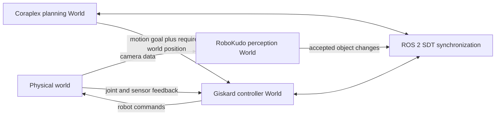

# Semantic digital twin synchronization research

First researched 2026-09-18 and finalized 2026-09-19, before PR 13, at
cognitive_robot_abstract_machine `12e9aa1e4`, robokudo_foundation_pose `1ef9a96`,
noctis `ba76bbc`. No end-to-end integration or performance benchmark was run.

Trimmed on 2026-11-20 to what stays useful after PR 13 and the chosen approach
E3b ([discussion record](coraplex_belief_consumption_discussion.md),
[chosen approach](coraplex_belief_consumption.md)). Removed:

- the ranking of the three options, because each one now has an E-option
  (on-demand detection is E1, native connector and synchronization is E3/E3b,
  and a separate ROS bridge is only a fallback for a separate deployment);
- the findings about bounding-box body poses, shape clearing and kind gating,
  which PR 13 has already addressed for the aircraft parts.

The one idea left over from those options is E6, below.

## E6: E3b, plus waiting for a fresh observation at perception points

Status: proposal. Nothing has been implemented. It comes from the research's
"plan coordination" for the native connector, which E3b does not cover yet.

**How it works.**

- Everything is set up as in E3b: RoboKudo writes beliefs into the shared world,
  and Coraplex holds incoming updates back.
- At a perception point in a plan, for example before a grasp, a plan node:
  1. asks RoboKudo for one perception cycle on the part and gets back RoboKudo's
     `latest_published_position`;
  2. applies the held-back updates (`apply_missed_messages()`);
  3. waits, with a timeout, until Coraplex's synchronizer `has_applied` that
     position;
  4. checks that the part's last accepted capture time is newer than the robot's
     last action on that part (Q4).
- The motion that follows uses a pose known to be fresh.
- Between perception points, updates are still applied between plans, as in E3b.

**Connector and synchronizer:** as in E3b. In addition, the stream positions are
used to check freshness.

**Already exists:**

- `StreamPosition`, `latest_published_position` and `has_applied`
  (`semantic_digital_twin/src/semantic_digital_twin/adapters/ros/world_synchronizer.py:76`,
  `:249`, `:254`).
- Giskard already uses this pattern: `wait_for_the_changes_of_a_goal`
  (`giskardpy/src/giskardpy/middleware/ros2/world_updates.py:119`) waits until
  Giskard's own changes have arrived.
- PR 13 keeps each belief's last accepted capture time
  ([connector spec](semantic_digital_twin_connector.md), "Absence and invalid
  observations").

**Missing:**

- a RoboKudo request that runs one cycle and returns the published position;
- the Coraplex plan node that runs steps 1-4;
- out-of-order rejection and jump gating for observations, and a stale policy.
  PR 13 lists stale, lost and removal policies as out of scope. Step 4 and Q4
  depend on these.

**Changes:**

- E3b's changes.
- `robokudo_acrambly/`: a service or action that runs a cycle and returns the
  position, plus the out-of-order and jump checks. *Small-medium.*
- `coraplex/`: a plan node that replaces `DetectAction` for aircraft parts.
  **Outside.** *Small-medium.*

**Pros:**

- Everything E3b has.
- It removes E3b's "pose one perception cycle old" con where it matters, before
  a grasp.
- It answers Q3 with a rule: apply updates between plans, and wait for a fresh
  observation at grasp points.

**Cons:**

- Needs a `coraplex/` change.
- A grasp waits for one perception cycle (but not the 10 s query).
- Two writers on a held part remain. Only a rule about who controls the pose fixes
  that (Q4, and item 3 of the contract below).

**Score** with the discussion record's rubric: 71, the value it already gives E3b
when updates are applied inside a running plan. E3b stays the starting point, and
E6 is its next step.

**Order of steps:** request or await a fresh observation, resolve the part's
persistent belief, check its age and pose, wait until the update has been
applied, then plan, reach and grasp. Let the gripper attachment control the pose
while the part is held, place it, and observe it again.

## Understanding the problem from the basics

Imagine that a robot needs to pick up a mustard bottle from a table. Its camera provides images, but its plan needs an object it can refer to, a location to reach, geometry for collision checking, and a way to know whether that information is still valid.

| Term | Plain-language meaning | Bottle example |
| --- | --- | --- |
| Segmentation | Identifying which image pixels belong to an object. | NOCTIS produces a mask covering the bottle and associates it with a known object model. |
| 6D pose | Three coordinates for position and three degrees of freedom for orientation. | FoundationPose estimates where the bottle is and how it is rotated. |
| Coordinate frame | The origin and axes relative to which a pose is expressed. | A bottle position relative to the camera must be converted before a plan uses it relative to the robot or room. |
| Digital twin | A computer representation of physical objects and their state. | A virtual bottle has a pose and a shape inside the robot's world model. |
| Semantic digital twin | A twin that also represents the meaning of entities and their relationships. | The virtual shape is represented as a bottle, with the semantic annotations needed by the plan. |
| Class or model identity | Which kind of object was recognized. | Two mustard bottles may use the same CAD model. |
| Instance identity | Which individual physical object an observation belongs to. | Bottle A and bottle B need different persistent identifiers even when they look identical. |
| Belief state | The robot's current estimate of the world, which may be incomplete or wrong. | An occluded bottle can remain in memory at its last accepted pose. |
| Synchronization | Keeping relevant world representations consistent as accepted information changes. | Perception updates bottle A; Coraplex and the motion controller receive that update before using its new pose. |

In the current stack, RoboKudo runs perception stages and stores their results as annotations. Its `ObjectHypothesis` represents a candidate object in an observation. An `ObjectBeliefState` can associate that hypothesis with a persistent SDT `Body`, identified by a UUID, a unique identifier. Coraplex expresses the robot's task, while Giskard handles motion execution. See [RoboKudo belief state](../../robokudo/src/robokudo/types/belief_state.py), [Coraplex perception](../../coraplex/src/coraplex/perception.py), and [Giskard world updates](../../giskardpy/src/giskardpy/middleware/ros2/world_updates.py).

A fresh detection does not automatically solve synchronization. The system still has to decide whether it saw the same bottle again, whether the pose is trustworthy, which twin body to update, and whether the planner has received that update.

There are also two types of twin change. Moving an existing bottle changes its **state**. Adding a new bottle, installing its geometry, or changing how it is attached changes the **model structure**. This matters because the controller can handle pose updates differently from changes that invalidate an already compiled motion. The existing [Giskard update interface](../../giskardpy/src/giskardpy/middleware/ros2/world_updates.py) makes that distinction.

## How many worlds are there?

The short answer depends on how the system is being run:

- A real-robot deployment with Coraplex, Giskard, and RoboKudo has **one physical world and normally three live software world instances**.
- The current Coraplex simulation path normally has **one live software world instance**, shared by planning, simulated motion, and simulated perception.
- Optional simulators, databases, or additional robot processes can introduce more representations or copies.

There is one environment the robot operates in, but each process has separate memory. Two processes cannot hold the same Python `World` object. They can only hold distinct objects that describe the same environment and exchange changes through ROS 2.

### The physical world

This is the real room, robot, table, camera, and bottle. It is not a `semantic_digital_twin.world.World` object and cannot be synchronized directly. Sensors produce observations of it; the software worlds contain the robot's current beliefs about it. The physical world always remains the final source of truth, even when the robot's belief is stale or wrong.

### World 1: Giskard's controller world

Giskard owns a `World` inside `world_config.world`. This is the world used to compile and execute motion, read robot state, calculate kinematics, and perform collision checking. During a real run, Giskard exposes a service from which another process can fetch a snapshot and attaches a `WorldSynchronizer` for later changes. Incoming changes are buffered so they are applied at safe control-loop boundaries. See [Giskard setup](../../giskardpy/src/giskardpy/middleware/ros2/giskard.py) and [incoming update handling](../../giskardpy/src/giskardpy/middleware/ros2/world_updates.py).

### World 2: Coraplex's planning world

For a real run, Coraplex fetches a copy of Giskard's world and attaches its own `WorldSynchronizer`. The plan resolves semantic objects and builds motions against this local copy. When Coraplex changes the scene, the synchronizer publishes the change. When Giskard changes state during execution, Coraplex receives that change. Stream positions let the two sides wait until required updates have arrived rather than assuming that a ROS message was instantaneous. See [Coraplex world acquisition](../../coraplex/src/coraplex/demonstrations.py) and [Giskard client synchronization](../../giskardpy/src/giskardpy/middleware/ros2/python_interface.py).

### World 3: RoboKudo's perception world

RoboKudo has a module-level, singleton-like `World` for its running perception pipeline. Its connector associates current `ObjectHypothesis` observations with `ObjectBeliefState` records and SDT bodies in this world. Being singleton-like means that RoboKudo code in one Python process shares this central instance; it does not mean that Coraplex and Giskard automatically share it. See [RoboKudo world](../../robokudo/src/robokudo/world.py) and [semantic connector](../../robokudo/src/robokudo/annotators/semantic_world_connector.py).

RoboKudo does not attach a `WorldSynchronizer` to this world today, so updating it does **not** update the Coraplex or Giskard worlds. E3/E3b fix this by having RoboKudo start from the fetched shared world and attach a synchronizer.

### How the three live worlds relate in a real run

The goal is **consistent copies**, not one shared memory object. They may briefly differ because observations, network messages, and safe update points take time. A plan must therefore require a sufficiently fresh observation and wait for its accepted update when that freshness matters (E6).

The three copies also have different responsibilities:

| World | Owns or decides | Should not decide alone |
| --- | --- | --- |
| RoboKudo perception world | Raw observations, observation association, perception quality | Whether a motion is safe to execute |
| Coraplex planning world | Task meaning, object selection, action sequence | Low-level control state |
| Giskard controller world | Motion-time robot state, kinematics, collision checking, safe application of updates | Semantic identity from raw images |

This division keeps several processes from deciding the same fact. For example, while bottle A is free on the table, perception can propose its pose. Once the robot grasps it, the gripper attachment and controller should determine its pose. Perception may still observe it, but should not fight the attachment by independently moving the same body.

### What happens in Coraplex simulation?

The current simulated demonstration builds one local `World`. The Coraplex context, local Giskard executor, and `WorldPerception` all use that same Python object. `WorldPerception` reads the pose already stored in the simulated world, so it behaves like a perfect sensor rather than calling NOCTIS or FoundationPose. See [simulated world acquisition](../../coraplex/src/coraplex/demonstrations.py), [simulated execution](../../coraplex/src/coraplex/plans/executables.py), and [perception source selection](../../coraplex/src/coraplex/perception.py).

This is useful for testing plan logic, but it does not test camera transforms, object association, perception latency, or synchronization between processes.

### Things called a world that do not add another live world

- **RViz visualization** displays markers and transforms published from a world; it is not another authoritative SDT world.
- **The ROS tf2 tree** stores coordinate-frame relationships; it is not an object and semantic world model.
- **RoboKudo CAS** stores sensor data and annotations for an analysis cycle; it is not the persistent SDT world.
- **A database or serialized world** is a stored model or snapshot. It becomes another live world only after a process loads it into a `World` instance.
- **A world descriptor or configuration** is a recipe used to construct a world. Temporary `World` objects can exist while loading or testing, but they are not necessarily members of the running architecture.

## Local integration findings that still apply

### Synchronization

[WorldSynchronizer](../../semantic_digital_twin/src/semantic_digital_twin/adapters/ros/world_synchronizer.py) replicates accepted world changes and records per-publisher stream positions. It does not infer observation identity or establish a global order across competing writers. [Giskard world updates](../../giskardpy/src/giskardpy/middleware/ros2/world_updates.py) already distinguish structural changes from state changes and expose applied stream positions. A plan must make sure it has received the perception publisher's accepted update before constructing its next motion; the client's own publication position alone does not show that another publisher's observation is fresh (E6).

### Policies the connector does not provide

The connector does not delete unseen objects, mark beliefs stale, track calibrated pose uncertainty, or handle a part attached to the gripper. Design these around the plan's needs. An occluded object should not by itself count as evidence that it has left the world.

### Real perception: FoundationPose and NOCTIS

These matter once a real perception pipeline replaces the scripted aircraft source. They are static code findings, not reproduced runtime failures.

FoundationPose supports pose estimation and tracking, with either a CAD model or reference-image setup according to its official repository. Those capabilities do not establish semantic identity or implement digital-twin synchronization. Verify the particular RoboKudo wrapper's outputs, model frame, units, timestamps, and available tracking mode separately. [FoundationPose official implementation](https://github.com/NVlabs/FoundationPose).

- The local [FoundationPose annotator](../../../robokudo_foundation_pose/robokudo_foundation_pose/robokudo_foundation_pose/annotator/foundation_pose_annotator.py) requires masks plus classification-to-mesh mapping.
- It emits `self.twc @ poses_tco` as a plain `PoseAnnotation`, but the connector reads plain poses as camera-relative and transforms them into the world. Unless the wrapper's camera transform is the identity, that applies the transform twice.
- Its camera extrinsics are set once at setup; a moving camera needs transforms at observation time.
- It references `CASViews.CAM_INTRINSIC`, while this checkout's [CAS](../../robokudo/src/robokudo/cas.py) defines `CASViews.CAMERA_INTRINSIC`.
- It reads depth with a millimeter-to-meter conversion; verify the actual reader's units.
- NOCTIS being RGB-only does not remove the wrapper's depth requirement.
- No NOCTIS adapter exists in the local RoboKudo source; masks, ROI, class/model identity and scores need a conversion step.
- FoundationPose tracking needs previous poses supplied on the right persistent hypotheses; enabling its tracking mode alone does not provide that association.

## Requirements PR 13 does not yet meet

PR 13 already gives each accepted observation a stable belief UUID with its capture
time and frame, and creates geometry and semantics once before updating only the
pose. These remain:

1. Transform camera-frame poses at the observation time when the camera moves,
   with a known camera-to-world calibration.
2. Reject out-of-order observations and gate implausible jumps.
3. While a part is grasped, decide whether perception or the gripper attachment
   controls its pose, so the two never write the same pose (Q4).
4. Let plans request or await a fresh accepted observation before sensitive
   manipulation steps, while native synchronization keeps other world instances
   current (E6).

Online API documentation and the local checkout can differ. The local
implementation governs any implementation plan.
